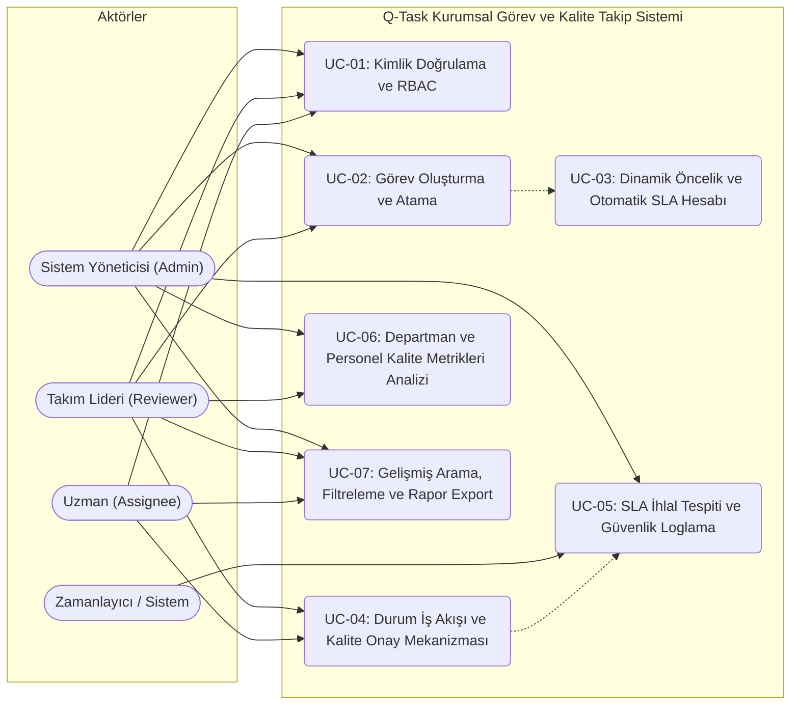

# PROJE RAPORU: FAZ 1 ÇIKTILARI

* **Proje Adı:** Q-Task: Kurumsal Görev, Kalite ve SLA (Hizmet Seviyesi) Takip Sistemi
* **Ders:** Yazılım Kalite Standartları
* **Ekip Büyüklüğü:** 7 Kişi

---

## 1. Ekiplerin, Görevlerin ve Yapılacak Katkıların Belirlenmesi (Faz 1 - i)

Proje kapsamında iş yükü 7 ekip üyesi arasında dengeli ve birbirini tamamlayacak şekilde dağıtılmıştır. Her üye hem belirli bir yazılım yaşam döngüsü (SDLC) ve kalite rolünden hem de en az bir ana Kullanım Durumu (Use Case) ve ilgili modülün uçtan uca geliştirilmesinden sorumludur.

| Üye No | Öğrenci Adı & No | Proje Rolü | Sorumlu Olduğu Faz Görevleri ve Katkılar | Sorumlu Olduğu Use Case |
| :--- | :--- | :--- | :--- | :--- |
| **Üye 1** | **Alperhan Karşı** *(Öğrenci No)* | **Ekip Lideri & Yazılım Mimarı (Team Lead & Architect)** | GitHub repo yönetimi, Faz 1 süreç/araç kurulumu, Faz 3 mimari tasarım kararları, Faz 4 CI/CD (Devreye alım) boru hattı kurulumu ve kod birleştirme (PR) onayları. | **UC-01:** Kullanıcı Kimlik Doğrulama ve Rol Tabanlı Erişim Kontrolü (RBAC) |
| **Üye 2** | **Üye 2 Adı Soyadı** *(Öğrenci No)* | **İş Analisti & Gereksinim Mühendisi** | Faz 1 fonksiyonel/fonksiyonel olmayan gereksinimlerin analizi, Faz 2 gereksinim gözden geçirme (review) liderliği, izlenebilirlik matrisi ve DIR beyanlarının konsolidasyonu. | **UC-02:** Kurumsal Görev (Task) Oluşturma, Kategorizasyon ve Atama Modülü |
| **Üye 3** | **Üye 3 Adı Soyadı** *(Öğrenci No)* | **Çevik Süreç Yöneticisi (Scrum Master) & Backend Geliştirici** | Sprint planlamaları, Kanban/Scrum panosu takibi, iş kuralları motorunun (SLA hesaplama algoritması) geliştirilmesi ve Faz 3 kod gözden geçirme (Code Review) organizasyonu. | **UC-03:** Dinamik Önceliklendirme ve Otomatik SLA (Hizmet Süresi) Hesaplama Modülü |
| **Üye 4** | **Üye 4 Adı Soyadı** *(Öğrenci No)* | **Kalite Güvence (QA) ve Test Lideri** | Faz 2 Kalite Kapılarının (Quality Gates) ve Test Planının hazırlanması, Faz 4 Kara Kutu (Black-Box) test senaryolarının (Denklik Payları, Sınır Değer Analizi) yürütülmesi. | **UC-04:** Görev Durum İş Akışı (State Machine) ve Kalite Onay (Review) Mekanizması |
| **Üye 5** | **Üye 5 Adı Soyadı** *(Öğrenci No)* | **Güvenlik ve Risk Uzmanı (DevSecOps)** | Faz 2 Güvenlik Risk Değerlendirmesi (OWASP Top 10 & STRIDE), Faz 3 güvenli kodlama denetimleri (Bandit/SonarCloud entegrasyonu) ve denetim izi (Audit Log) yapısı. | **UC-05:** SLA İhlal Tespiti, Eskalasyon (Üst Birime Aktarım) ve Güvenlik Loglama Modülü |
| **Üye 6** | **Üye 6 Adı Soyadı** *(Öğrenci No)* | **Kıdemli Backend Geliştirici & Beyaz Kutu Test Uzmanı** | Veritabanı şema tasarımı, Faz 4 Beyaz Kutu (White-Box) birim testlerinin (`pytest`) yazılması, kod kapsama (Coverage) analizi ve **McCabe Döngüsel Karmaşıklık** hesaplamaları. | **UC-06:** Departman ve Personel Performans / Kalite Metrikleri Analiz Modülü |
| **Üye 7** | **Üye 7 Adı Soyadı** *(Öğrenci No)* | **Ön Yüz (UI/UX) Geliştirici & Dokümantasyon Sorumlusu** | Kullanıcı arayüzü geliştirme, Faz 4 Kullanıcı Kabul Testleri (UAT), Faz 5 nihai rapor formatlama, referans yönetimi ve sunum/demo hazırlığı. | **UC-07:** Gelişmiş Arama, Filtreleme ve Kurumsal Rapor Dışa Aktarma (CSV/PDF Export) |

---

## 2. Tech Stack, Araç Seti, Süreç ve Zaman Planı (Faz 1 - ii)

### 2.1. Teknoloji Yığını (Tech Stack) ve Kalite Araç Seti

Projede, yazılım kalite standartlarının (ISO/IEC 25010) ölçülebilirliğini ve otomasyonunu en üst düzeye çıkarmak amacıyla **Python** tabanlı modern ve modüler bir mimari seçilmiştir:

* **Programlama Dili ve Çatı (Framework):** Python 3.11+, FastAPI (RESTful API ve İş Mantığı Katmanı), Streamlit (Hızlı ve Etkileşimli Kurumsal Arayüz Katmanı).
* **Veritabanı ve ORM:** SQLite ve SQLAlchemy ORM, Pydantic (Veri doğrulama ve şema kontratları).
* **Versiyon Kontrol ve CI/CD:** Git, GitHub, GitHub Actions (Otomatik test ve kalite kapısı kontrolü).
* **Kalite Güvence, Test ve Statik Analiz Araçları:**
  * `pytest` & `pytest-cov`: Beyaz kutu birim testleri ve satır/dal bazlı kod kapsama (Code Coverage) ölçümü.
  * `radon`: Faz 4'te modül bazında **McCabe Döngüsel Karmaşıklık (Cyclomatic Complexity)** ve Bakım Yapılabilirlik İndeksi (Maintainability Index) hesaplaması.
  * `flake8` & `black`: PEP-8 kodlama standartları ve stil kontrolü (Linter).
  * `bandit`: Python kodundaki güvenlik zafiyetlerinin statik analizi (SAST).
* **Kullanılan Yapay Zeka Araçları:** Google Gemini (Gereksinim analizi, mimari tartışma, test senaryosu üretimi ve kod refaktöring desteği — *Tüm kullanımlar DIR metodolojisi ile kayıt altına alınmaktadır*).

### 2.2. İş Yapış Şekli (Çevik Süreç - Hibrit Scrum/Kanban)

Ekip, dersin 2-3 haftalık faz teslim döngülerine uyum sağlamak amacıyla **Scrumban (Scrum + Kanban)** metodolojisini benimsemiştir:

1. **Sprint Döngüleri:** Her proje fazı (Faz 1 - Faz 5) bir **Sprint (2-3 Hafta)** olarak kabul edilir.
2. **Kanban Panosu (GitHub Projects):** İş kalemleri `Backlog` -> `Ready` -> `In Progress` -> `Quality Gate / Code Review` -> `Testing` -> `Done` sütunlarında takip edilir.
3. **Bitti Tanımı (Definition of Done - DoD):** Bir görev ancak; kodu yazılıp PEP-8 standartlarına uyduğunda, en az 1 ekip arkadaşı tarafından gözden geçirildiğinde (Peer Review), birim testlerinden geçtiğinde ve ilgili **DIR beyanı** yazıldığında `Done` sütununa taşınabilir.

### 2.3. Zaman Planı (Takvim)

| Faz | Dönem / Süre | Temel Odak ve Teslimatlar | Sorumlu Lider |
| :--- | :--- | :--- | :--- |
| **Faz 1** | Hafta 1 - 3 | Ekip kurulumu, Tech Stack, Süreç planı, Kapsam ve 7 Use Case tanımı. | Üye 1 & Üye 2 |
| **Faz 2** | Hafta 4 - 6 | Faz 1 Review, Kalite Kapıları (Quality Gates), Test Planı, Güvenlik Risk Analizi. | Üye 4 & Üye 5 |
| **Faz 3** | Hafta 7 - 9 | Faz 2 Review, Mimari alternatifler ve kararlar, Kodlama ve Code Review. | Üye 1 & Üye 3 |
| **Faz 4** | Hafta 10 - 12 | Faz 3 Review, Beyaz/Kara Kutu Testleri, McCabe Karmaşıklık Analizi, Devreye Alım. | Üye 6 & Üye 4 |
| **Faz 5** | Hafta 13 - 14 | Faz 4 Review, Nihai Rapor (Max 20 syf), DIR Beyanları, Canlı Demo ve Sunum. | Üye 7 & Tüm Ekip |

---

## 3. Proje Konusu, Kapsamı ve Gereksinimler (Faz 1 - iii)

### 3.1. Proje Konusu ve Amacı

**Q-Task (Kurumsal Görev, Kalite ve SLA Takip Sistemi)**; yazılım ve teknoloji şirketlerinde departmanlar arası açılan görevlerin (hata kaydı, yeni özellik talebi, altyapı bakımı, güvenlik yaması vb.) yaşam döngüsünü yöneten, görevin kritiklik derecesine göre **otomatik SLA (Hizmet Seviyesi Anlaşması - Çözüm Süresi)** hesaplayan, kalite onay kapılarından geçmeyen görevlerin kapatılmasını engelleyen ve personel/departman bazlı kalite metrikleri üreten bir kurumsal web uygulamasıdır.

### 3.2. Temel Fonksiyonel (FR) ve Fonksiyonel Olmayan Kalite Gereksinimleri (NFR)

* **FR-01:** Sistem, kullanıcıları `Admin`, `Takım Lideri (Reviewer)` ve `Uzman (Assignee)` rollerine göre yetkilendirmelidir.
* **FR-02:** Görev oluşturulurken aciliyet, etki alanı ve kategori bilgilerine göre dinamik bir öncelik skoru ve SLA bitiş tarihi (Deadline) otomatik hesaplanmalıdır.
* **FR-03:** Görevler belirli bir durum makinesi (`OPEN` -> `IN_PROGRESS` -> `IN_REVIEW` -> `DONE` / `REOPENED`) kurallarına göre ilerlemelidir.
* **NFR-01 (Bakım Yapılabilirlik - Maintainability):** Hiçbir fonksiyonun McCabe Döngüsel Karmaşıklık (Cyclomatic Complexity) değeri **10'u geçmemelidir** (Hedef: <= 7).
* **NFR-02 (Güvenilirlik & Test Edilebilirlik):** İş mantığı (Business Logic) modüllerinde birim test kapsama oranı (Code Coverage) **en az %80** olmalıdır.
* **NFR-03 (Güvenlik):** Parolalar düz metin olarak saklanmamalı (SHA-256 + Salt ile özetlenmeli), tüm kritik durum geçişleri değiştirilemez denetim günlüğüne (Audit Log) kaydedilmelidir.

### 3.3. Sistem Use Case Diyagramı

---

### 3.4. Kullanım Durumları (Use Cases) — (Kişi Başı 1 Adet, Toplam 7 Use Case)

| Alan | UC-01: Kullanıcı Kimlik Doğrulama ve Rol Tabanlı Erişim Kontrolü (RBAC) |
| :--- | :--- |
| **Sorumlu Üye** | **Üye 1 (Alperhan Karşı)** |
| **Aktörler** | Tüm Kullanıcılar (`Admin`, `Takım Lideri`, `Uzman`) |
| **Ön Koşullar** | Kullanıcının sistem veritabanında aktif bir hesabının bulunması. |
| **Temel Akış** | 1. Kullanıcı, kullanıcı adı ve şifresini girerek giriş talebinde bulunur. 2. Sistem, girilen şifreyi kriptografik özet (SHA-256 hash) fonksiyonundan geçirerek veritabanındaki kayıtla karşılaştırır. 3. Doğrulama başarılıysa, kullanıcının rolünü (`Admin`, `Lead`, `Specialist`) yükler ve oturum başlatır. 4. Kullanıcıya yalnızca kendi rolünün yetkili olduğu menü ve işlem butonları gösterilir. |
| **Alternatif / Hata Akışı** | **3a:** Şifre hatalıysa veya 6 karakterden kısaysa sistem hata döner, başarısız giriş sayacını artırır. Ardışık 5 hatalı girişte hesabı 15 dakika kilitler ve güvenlik logu üretir. |
| **Son Koşullar** | Kullanıcı güvenli bir şekilde sisteme erişir ve yetki sınırları uygulanır. |

 

| Alan | UC-02: Kurumsal Görev (Task) Oluşturma, Kategorizasyon ve Atama |
| :--- | :--- |
| **Sorumlu Üye** | **Üye 2** |
| **Aktörler** | `Takım Lideri`, `Admin` |
| **Ön Koşullar** | Kullanıcının sisteme giriş yapmış ve görev oluşturma yetkisine sahip olması. |
| **Temel Akış** | 1. Kullanıcı "Yeni Görev Oluştur" formunu açar; Başlık, Açıklama, Kategori (`Bug`, `Feature`, `Security`, `Maintenance`), Etki Seviyesi (1-5) ve Aciliyet (1-5) bilgilerini girer. 2. Görevin atanacağı uzmanı (Assignee) seçer ve kaydet butonuna basar. 3. Sistem, veri şeması doğrulamasını (boş alan kontrolü, karakter sınırları) yapar. 4. Doğrulama başarılıysa görev benzersiz bir ID ile `OPEN` durumunda kaydedilir. |
| **Alternatif / Hata Akışı** | **3a:** Başlık 5 karakterden kısaysa veya atanacak uzmanın üzerinde maksimum kapasitede (>5 aktif kritik görev) iş varsa sistem uyarı verir ve kaydı engeller. |
| **Son Koşullar** | Görev veritabanına kaydedilir ve SLA hesaplama modülü (UC-03) tetiklenir. |

 

| Alan | UC-03: Dinamik Önceliklendirme ve Otomatik SLA Hesaplama |
| :--- | :--- |
| **Sorumlu Üye** | **Üye 3** |
| **Aktörler** | `Sistem (Otomatik Tetiklenir)`, `Takım Lideri` |
| **Ön Koşullar** | UC-02 kapsamında geçerli bir görev verisinin oluşturulmuş olması. |
| **Temel Akış** | 1. Sistem, görevin Kategori, Etki (1-5) ve Aciliyet (1-5) parametrelerini alır. 2. Ağırlıklı algoritma ile **Öncelik Skoru** hesaplar (`Security` için 1.5x, `Bug` için 1.2x çarpan uygulanır). 3. Hesaplanan skora göre görevi `P1 - Kritik`, `P2 - Yüksek`, `P3 - Orta` veya `P4 - Düşük` olarak sınıflandırır. 4. Sınıfa karşılık gelen maksimum çözüm süresini (P1: 4 saat, P2: 24 saat, P3: 72 saat, P4: 168 saat) oluşturulma zamanına ekleyerek **SLA Bitiş Tarihini (Deadline)** belirler. |
| **Alternatif / Hata Akışı** | **2a:** Geçersiz bir parametre değeri (1-5 aralığı dışında sayı) gelirse sistem `ValueError` fırlatır ve işlemi engeller. |
| **Son Koşullar** | Görevin öncelik seviyesi ve SLA hedef süresi veritabanına işlenir. |

 

| Alan | UC-04: Görev Durum İş Akışı (State Machine) ve Kalite Onay (Review) Mekanizması |
| :--- | :--- |
| **Sorumlu Üye** | **Üye 4** |
| **Aktörler** | `Uzman (Assignee)`, `Takım Lideri (Reviewer)` |
| **Ön Koşullar** | Görevin `OPEN` veya `IN_PROGRESS` durumunda olması. |
| **Temel Akış** | 1. Uzman, üzerinde çalıştığı görevi `IN_PROGRESS` durumuna alır. 2. Çalışmayı bitirdiğinde çözüm açıklamasını girerek görevi `IN_REVIEW` (Kalite Kontrolü) durumuna taşır (Uzman görevi doğrudan `DONE` yapamaz). 3. Takım Lideri görevi inceler; kalite kriterlerini sağlıyorsa onaylayarak `DONE` durumuna geçirir. |
| **Alternatif / Hata Akışı** | **3a (Kalite Reddi):** Takım Lideri çözümü yetersiz bulursa ret gerekçesini yazar ve görevi `REOPENED` durumuna çevirir; görevin "Yeniden İşleme (Rework) Sayacı" 1 artırılır. |
| **Son Koşullar** | Görev yalnızca kalite onayından geçerek kapatılır ve kalite metriği güncellenir. |

 

| Alan | UC-05: SLA İhlal Tespiti, Eskalasyon ve Güvenlik/Denetim Loglama (Audit Trail) |
| :--- | :--- |
| **Sorumlu Üye** | **Üye 5** |
| **Aktörler** | `Sistem`, `Güvenlik/Denetim Yöneticisi (Admin)` |
| **Ön Koşullar** | Sistemde aktif görevlerin ve kullanıcı işlemlerinin bulunması. |
| **Temel Akış** | 1. Sistem, aktif görevlerin mevcut zaman ile SLA Bitiş Tarihi (Deadline) arasındaki farkı kontrol eder. 2. Süresi dolduğu halde tamamlanmayan görevleri `SLA_BREACHED` olarak işaretler ve eskalasyon uyarısı üretir. 3. Sistemde gerçekleşen her durum değişikliği, yetki hatası ve SLA ihlali; `Zaman Damgası`, `Kullanıcı ID`, `İşlem Tipi`, `Eski Değer` ve `Yeni Değer` bilgileriyle Denetim Günlüğüne (Audit Log) kaydedilir. |
| **Alternatif / Hata Akışı** | **2a:** SLA süresinin dolmasına %20'den az süre kalmışsa sistem görevi `AT_RISK` olarak işaretler. |
| **Son Koşullar** | SLA ihlalleri görünür hale gelir ve tam izlenebilirlik (traceability) sağlanır. |

 

| Alan | UC-06: Departman ve Personel Performans / Kalite Metrikleri Analizi |
| :--- | :--- |
| **Sorumlu Üye** | **Üye 6** |
| **Aktörler** | `Takım Lideri`, `Admin` |
| **Ön Koşullar** | Sistemde tamamlanmış veya işlem görmüş görev kayıtlarının bulunması. |
| **Temel Akış** | 1. Yönetici "Kalite ve Performans Analitiği" ekranını açar. 2. Sistem; tamamlanan görev sayısı, **SLA Uyum Oranı (%)**, **İlk Seferde Doğru Yapma Oranı (First Time Right % - Rework görmeden kapanan görevler)** ve ortalama çözüm süresini (MTTR) hesaplar. 3. Hesaplanan metrikler departman ve personel bazında kalite skor kartı olarak gösterilir. |
| **Alternatif / Hata Akışı** | **2a:** Seçilen dönemde hiç tamamlanmış görev yoksa sıfıra bölünme (`ZeroDivisionError`) hatasını önleyerek tüm metrikleri güvenli şekilde `0.0%` olarak döner. |
| **Son Koşullar** | Kurumsal kalite durumu matematiksel metriklerle raporlanır. |

 

| Alan | UC-07: Gelişmiş Arama, Filtreleme ve Kurumsal Rapor Dışa Aktarma (Export) |
| :--- | :--- |
| **Sorumlu Üye** | **Üye 7** |
| **Aktörler** | Tüm Kullanıcılar |
| **Ön Koşullar** | Kullanıcının oturum açmış olması. |
| **Temel Akış** | 1. Kullanıcı görev listesi ekranında Durum, Öncelik (P1-P4), Kategori, SLA Durumu veya Anahtar Kelime filtrelerini seçer. 2. Sistem, SQL enjeksiyonuna karşı parametrik sorgular kullanarak eşleşen görevleri listeler. 3. Kullanıcı "Raporu Dışa Aktar (CSV/JSON)" butonuna tıklar; sistem filtrelenmiş listeyi ve özet kalite istatistiklerini indirilebilir dosya olarak sunar. |
| **Alternatif / Hata Akışı** | **2a:** Filtre kriterlerine uyan kayıt bulunamazsa kullanıcıya bilgilendirme mesajı gösterilir ve dışa aktarma butonu pasif hale getirilir. |
| **Son Koşullar** | Kullanıcı aradığı görev verilerine ulaşır ve dışa aktarır. |

---

### 3.5. Gereksinim - Use Case - Kalite Özelliği İzlenebilirlik Matrisi

| Use Case Kodu | Use Case Adı | Sorumlu Üye | İlgili Gereksinim | ISO/IEC 25010 Kalite Karakteristiği | Faz 4'te Uygulanacak Doğrulama / Test Yöntemi |
| :--- | :--- | :--- | :--- | :--- | :--- |
| **UC-01** | Kimlik Doğrulama ve RBAC | Üye 1 (Alperhan) | FR-01, NFR-03 | **Güvenlik (Security)** - Gizlilik & Bütünlük | Kara Kutu (Yetkisiz Erişim Testi) & Bandit SAST |
| **UC-02** | Görev Oluşturma ve Atama | Üye 2 | FR-02 | **Fonksiyonel Uygunluk (Functional Suitability)** | Denklik Payları ve Sınır Değer Analizi (Kara Kutu) |
| **UC-03** | Dinamik Öncelik ve SLA Hesabı | Üye 3 | FR-02, NFR-01 | **Bakım Yapılabilirlik (Maintainability)** & Doğruluk | Beyaz Kutu Dal (Branch) Testi & **McCabe Analizi** |
| **UC-04** | Durum İş Akışı ve Kalite Onayı | Üye 4 | FR-03, NFR-02 | **Güvenilirlik (Reliability)** - Hata Toleransı | Durum Geçiş (State Transition) Testleri |
| **UC-05** | SLA İhlal ve Denetim Loglama | Üye 5 | NFR-03 | **Güvenlik (Security)** - Hesap Verebilirlik | Beyaz Kutu Birim Testi & Log Bütünlük Kontrolü |
| **UC-06** | Performans ve Kalite Metrikleri | Üye 6 | NFR-01, NFR-02 | **Fonksiyonel Doğruluk** & Test Edilebilirlik | Beyaz Kutu Sınır Koşulu (`ZeroDivision`) Testi |
| **UC-07** | Arama, Filtreleme ve Export | Üye 7 | FR-01, NFR-03 | **Kullanılabilirlik (Usability)** & Taşınabilirlik | Kullanıcı Kabul Testi (UAT) & SQLi Güvenlik Testi |

---

## 4. Faz 1 İçin DIR Yöntemi ile YZ Kullanım Beyanı

| DIR Boyutu | Puan | Açıklama ve Gözetim Kanıtı |
| :--- | :---: | :--- |
| **Keşfet (D - Discover)** | **5 / 5** | Üretim başlamadan önce yapay zekaya proje yönergesindeki tüm yapısal kısıtlamalar (7 kişilik ekip zorunluluğu, kişi başı en az 1 özgün Use Case, kopyala-yapıştır yasağı, ilerleyen fazlarda McCabe karmaşıklığı ve beyaz/kara kutu testlerine uygunluk gereksinimi) açıkça tanımlanmıştır. Konu olarak "Kurumsal Görev ve SLA Takip Sistemi" insan iradesiyle seçilmiş ve kabul kriterleri baştan belirlenmiştir. |
| **Etkileş (I - Interact)** | **4 / 5** | İlk aşamada 6 kişi üzerinden kurgulanan ekip taslağına müdahale edilerek ekip sayısı 7'ye çıkarılmış, her üyeye yazılım kalite yaşam döngüsüne (QA Lead, DevSecOps, Beyaz Kutu Test Uzmanı vb.) uygun spesifik roller atanması yönünde iteratif yönlendirme yapılmıştır. Use Case'lerin sadece basit CRUD işlemleri olmaması, Faz 4'te McCabe döngüsel karmaşıklık analizine veri sağlayacak algoritmik iş kuralları (dinamik SLA hesaplama, durum makinesi, rework sayacı) içermesi sağlanmıştır. |
| **Gözden Geçir (R - Review)** | **5 / 5** | Üretilen 7 Use Case ve gereksinimler; IEEE 830 / ISO/IEC/IEEE 29148 gereksinim mühendisliği standartlarına göre (belirsizlikten uzak olma, test edilebilirlik, izlenebilirlik) ekipçe incelenmiştir. Her Use Case'in alternatif/hata akışlarının Faz 4'teki sınır değer ve kara kutu testlerine doğrudan girdi oluşturduğu doğrulanmıştır. |
| **Final DIR Skoru** | **%80.0** | **Formül:** `(5 * 4 * 5) * 0.8 = %80.0` — **Senaryo B: İnsan Gözetimli Yazılım Mühendisliği** (`R = 5 >= 4` Veto Kuralı Başarılı). |
